# APEX GEN5 — جریان داده کامل از Telegram تا چرخه یادگیری
## نسخه 6.0.0 — نگارش حرفه‌ای و بصری — بر اساس متن ۲۲ ثانیه شما

> **فلسفه هسته:** این سند یک زنجیره تبدیل اطلاعات است، نه یک سیگنال‌ساز ساده
>
> `DATA → FACT → EVIDENCE → CONTEXT → PATTERN → SETUP → FORECAST → PROPOSAL → RISK → ACTION → REALITY → LESSON → VALIDATED IMPROVEMENT`

---

### ۱. هفت گزاره تفکیک‌ناپذیر — Invariant اصلی معماری

GEN5 این هفت جمله را هرگز با هم قاطی نمی‌کند:

| شماره | گزاره | لایه مالک |
| :--- | :--- | :--- |
| 1 | من این را مشاهده کردم | `MarketObservation` |
| 2 | من از آن این را استنباط کردم | `EvidenceEvent` |
| 3 | من فکر می‌کنم این اتفاق ممکن است رخ دهد | `Pattern / Setup` |
| 4 | احتمال آن را اینقدر برآورد کردم | `P / U / C` |
| 5 | من این معامله را پیشنهاد می‌کنم | `PortfolioProposal` |
| 6 | من اجازه می‌دهم این مقدار سرمایه در معرض ریسک قرار بگیرد | `RiskDecision` |
| 7 | این چیزی است که واقعاً اجرا شد | `Ledger / Outcome` |

> **قانون:** FVG نمی‌تواند معامله باز کند. Structure نمی‌تواند معامله باز کند. SMT نمی‌تواند معامله باز کند. Strategy نمی‌تواند Risk را دور بزند. AI نمی‌تواند سرمایه را مجاز کند. Optimizer نمی‌تواند مستقیم Live را تغییر دهد. Telegram نمی‌تواند مستقیم Order بفرستد.

---

### ۲. نمای کلی — یک نمودار، کل پروژه

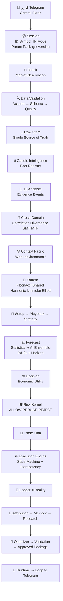

---

### ۳. ورود از Telegram — اتاق فرمان، نه موتور تحلیل

**نکته مهم:** Telegram تحلیل بازار انجام نمی‌دهد و مستقیم با صرافی معامله نمی‌کند.

**وظایف Control Plane:**

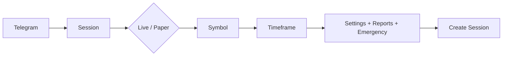

| ویژگی | توضیح |
| :--- | :--- |
| Session ID | قابل اتصال به تمام اتفاقات بعدی |
| Idempotency | تأیید Live به همان Session و همان Intent متصل است — کلیک قدیمی و منقضی نمی‌تواند معامله دیگر را تأیید کند |
| Risk | Telegram هرگز نمی‌تواند Risk را دور بزند |

**منوی اصلی — Full Unlock:**

```
APEX — Full Unlock — PAPER 10,000 USDT — UTC+3:30
[Trading] [Portfolio]
[Lab] [Info]
[Settings] [Emergency]
[Refresh] [Help]
```

---

### ۴. دریافت داده — Toobit → MarketObservation

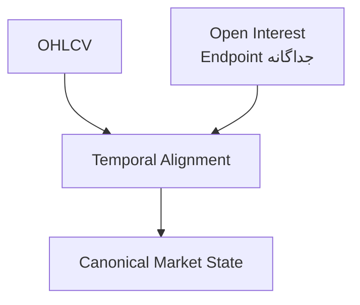

> **اصلاح مهم نسبت به برداشت قبلی:** Kline لزوماً همراه OI نیست. اگر OI از Endpoint جداگانه بیاید، ابتدا Observation مستقل است، سپس Temporal Alignment می‌شود.

**شیء استاندارد:**

| فیلد | نمونه |
| :--- | :--- |
| Symbol / Timeframe | BTCUSDT / 15m |
| OHLCV | Open 100 High 110 Low 98 Close 106 Volume 1234 |
| Open Interest | 45,231 |
| Open Time / Close Time / Retrieved At | 2026-08-24T12:00:00Z |
| Candle Status | `CLOSED` |
| Quality State | `Q0` |
| Source / Schema / Hash | Toobit / v1.0.0 / SHA256 |

---

### ۵. موتور دیتا — فقط اعتبارسنجی، نه تحلیل

> موتور دیتا نمی‌گوید بازار صعودی است یا FVG داریم. فقط می‌گوید: «آن چیزی که فکر می‌کنیم داده است، واقعاً معتبر است.»

```mermaid
flowchart LR
    A[Acquire] --> B[Schema Validation]
    B --> C[Timestamp Validation]
    C --> D[Ordering]
    D --> E[Duplicate Detection]
    E --> F[OHLC Consistency]
    F --> G[Volume/OI Plausibility]
    G --> H[Gap Detection]
    H --> I[Freshness Check]
    I --> J[Cross-Endpoint Alignment]
    J --> K[Quality State]
    K --> L[Canonical Storage]
```

---

### ۶. وضعیت کندل — جلوگیری از Future Leak

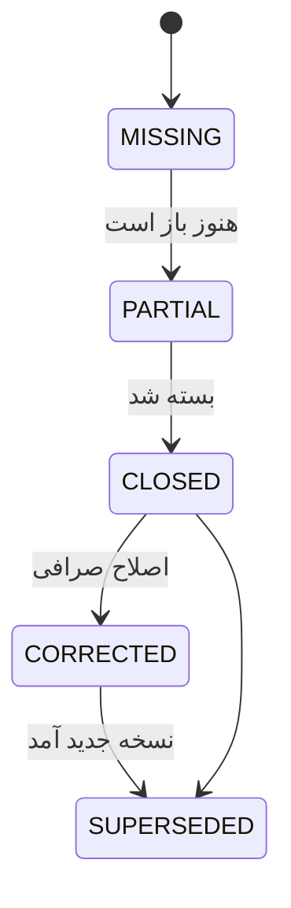

| وضعیت | اجازه استفاده در Backtest / Decision |
| :--- | :--- |
| `MISSING` | ❌ خیر |
| `PARTIAL` | ❌ خیر — نمی‌توانیم وانمود کنیم Close نهایی را می‌دانستیم |
| `CLOSED` | ✅ بله — فقط همین |
| `CORRECTED` | ⚠️ با lineage |
| `SUPERSEDED` | 📜 در ledger می‌ماند |

---

### ۷. Raw Store — یک حقیقت، نه کپی برای هر موتور

**تفاوت GEN5 با مدل قبلی شما:**

> شما قبلاً می‌گفتید: برای FVG یک Pack پنجاه کندلی، برای Backtest یک Pack دیگر، برای فلان موتور یک Pack دیگر
> در GEN5: **Raw Data Source of Truth فقط یکی است.**

```
RAW STORE (Canonical)
├── current window
├── 20 candles   → View
├── 50 candles   → View (FVG می‌خواهد)
├── 500 candles  → View (Regime می‌خواهد)
├── historical
└── research snapshots
```

**Data Manager — Lookback بر اساس نیاز:**

| مصرف‌کننده | Lookback | MTF مورد نیاز |
| :--- | :--- | :--- |
| Candle Feature A | 1 candle | 15m |
| FVG | 50 candles | 15m |
| OrderBlock | 100 candles | 15m |
| Structure | 200 candles | 15m + 1h |
| Regime | 500 candles | 15m + 1h + 4h + 1d |
| Harmonic | 300 candles | 15m + 1h + 4h |

> **چرا مهم؟** برای Poco + Termux سه سطح PEBBLE / BASTION / CITADEL — در حالت محدود، عمق محاسبات کم می‌شود ولی معنا تغییر نمی‌کند.

---

### ۸. Candle Intelligence — تبدیل مشاهده به حقیقت عددی

**نقش:** `Market Observation → Candle Facts` — «بازار چه کاری انجام داد؟»

#### Feature Registry — نه ۱۰۰ ویژگی ثابت

چون اگر Feature ۱۰۱ ارزش بیشتری داشته باشد، نباید معماری بشکند.

**دسته‌ها:**

- **پایه:** Body Size, Range, Upper Wick, Lower Wick, Body/Range, Close Position, Direction, Gap, Volume Ratio, OI Change, Range/ATR, Return
- **رابطه‌ای:** Current Body vs Previous, Current Range vs Rolling Range, Engulfment, Compression, Expansion, Directional Streak, Wick Asymmetry
- **بلندمدت:** چند کندلی و چند تایم‌فریمی

#### مثال واقعی:

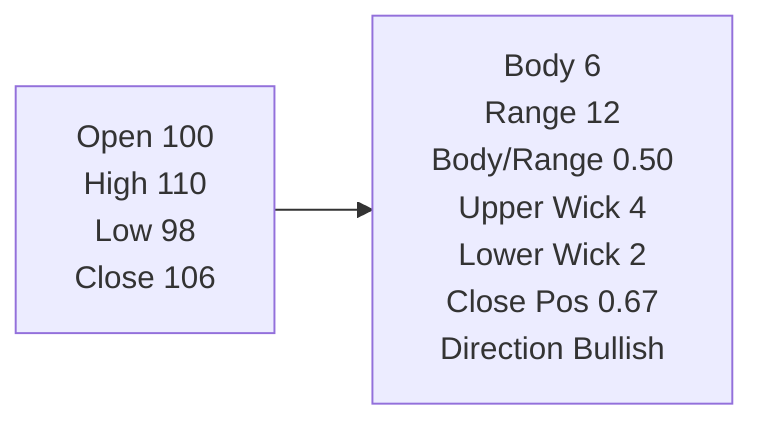

| محاسبه | مقدار | توضیح |
| :--- | :--- | :--- |
| Body | `|106-100| = 6` |  |
| Range | `110-98 = 12` |  |
| Body/Range | `6/12 = 0.50` | Fact مشتق‌شده، نه Parameter |
| Upper Wick | `110-106 = 4` |  |
| Lower Wick | `100-98 = 2` |  |

> **GEN5 صراحتاً:** `Feature ≠ Parameter` — `Observation ≠ Rule` — `Rule ≠ Forecast` — `Forecast ≠ Trade`

---

### ۹. قلب تحلیل — ۱۲ Analyst — رأی‌گیری نمی‌کنند

Candle Engine می‌گوید **چه اتفاقی افتاد؟**
۱۲ Analyst می‌گویند **از جنبه‌های مختلف چه معنایی دارد؟**

| شماره | حوزه تحلیلی | خروجی |
| :--- | :--- | :--- |
| 1 | Structure | Evidence |
| 2 | Liquidity | Evidence |
| 3 | Volume / Participation | Evidence |
| 4 | Volatility | Evidence |
| 5 | Imbalance / FVG | Evidence |
| 6 | OrderBlock | Evidence |
| 7 | ICT / SMC / RTM | Evidence |
| 8 | Wyckoff / Auction | Evidence |
| 9 | Trend | Evidence |
| 10 | Momentum | Evidence |
| 11 | Regime | Evidence |
| 12 | Session / Temporal | Evidence |

**خروجی هر Analyst — Evidence Event:**

```json
{
  "Source": "Structure Analyst",
  "Type": "Bullish BOS",
  "Strength": 84,
  "Confidence": 0.72,
  "Symbol": "BTCUSDT",
  "Timeframe": "15m",
  "Lookback": 200,
  "Validity": "20 candles",
  "Age": "2 candles",
  "ParameterVersion": "V17"
}
```

> Structure نمی‌گوید `Long = 80%` — می‌گوید `Bullish BOS Strength 84 Confidence 0.72`

---

### ۱۰. هر Analyst چگونه فکر می‌کند؟

#### Structure — BOS واقعی

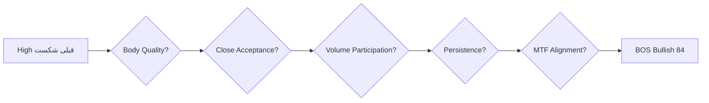

نه فقط `High شکسته شد → BOS`

#### Liquidity — Sweep واقعی

```
Equal Lows
↓
Price dips below (شکست)
↓
Rejection (واکنش مشخص)
↓
Returns above
```

**باید:** ۱. Reference Liquidity وجود داشته باشد ۲. قیمت آن را بشکند ۳. واکنش مشخص رخ دهد ۴. Persistence بررسی شود — صرفاً یک Wick پایین Sweep نیست

#### FVG — دارای چرخه عمر

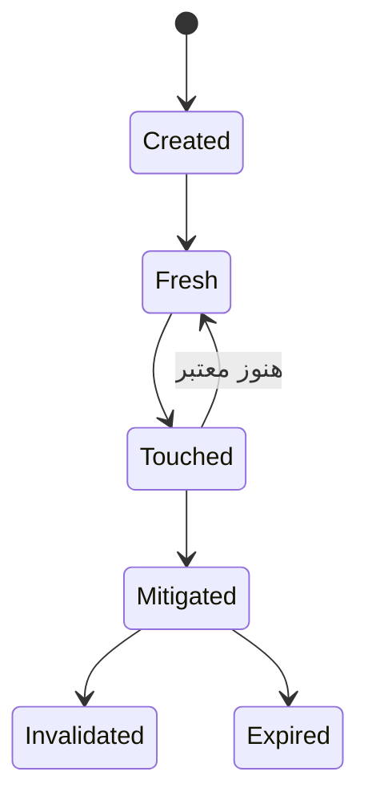

سن، تعداد Touch، میزان Mitigation و Context روی قدرت تأثیر می‌گذارند

#### OrderBlock — فراتر از آخرین کندل مخالف

باید: Origin + Displacement + Structural Consequence + Persistence + Mitigation

#### Trend — چهار مقیاس

| مقیاس | چه نگهداری می‌شود |
| :--- | :--- |
| Micro / Short / Intermediate / Macro | Direction, Strength, Persistence, Transition Probability, MTF Agreement |

#### Momentum — فراتر از RSI

Velocity, Acceleration, Deceleration, Impulse, Exhaustion, Divergence

> مثال: Price is still rising but velocity is decreasing → Exhaustion/Divergence Evidence

#### Regime — State Vector

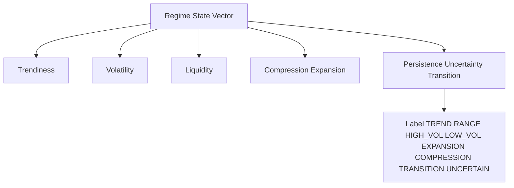

---

### ۱۱. Cross-Domain Intelligence — موتور شماره ۱۳ نیست!

**اینجا ابهام قبلی شما حل می‌شود.** Correlation، Divergence، SMT عمداً موتور ۱۳ نشده‌اند.

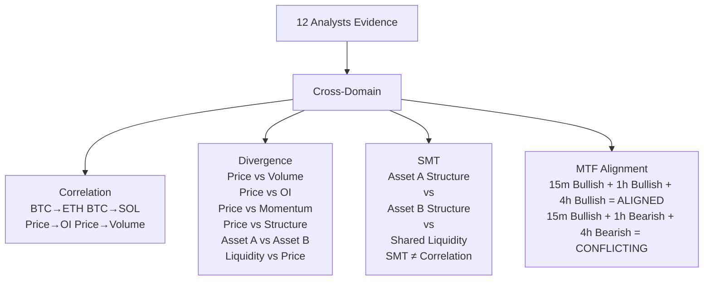

#### Conflict Resolver — جمع ساده نمی‌کند

فرض کن:
- Structure = Bullish 85
- Liquidity = Bearish 80
- Regime = Uncertain

سیستم ساده: `85 + 80 + ... = 82 → BUY` — اطلاعات مهم نابود می‌شود

GEN5:
> `CONFLICTING_HIGH_STRENGTH` — شواهد قوی هستند، ولی با هم در تضادند. این خودش یک Information State است و اجازه ورود را کاهش می‌دهد.

---

### ۱۲. Evidence Fabric + Context Fabric

**Evidence Fabric — شبکه استاندارد:**

```
EV001 = Bullish BOS
EV002 = Sell-side Sweep
EV003 = Fresh Bullish FVG
EV004 = Valid Bullish OB
EV005 = Bullish MTF Alignment
EV006 = Momentum Expansion
EV007 = SMT Bullish Divergence
EV008 = Trend Bullish
```

هر Evidence: Source, Timestamp, Symbol, TF, Strength, Confidence, Quality, Validity, Lifecycle, Parameter Version, Lineage

**Context Fabric — تصویر کلی:**

| بخش | مقدار نمونه |
| :--- | :--- |
| Market Regime | Trend |
| Trend Stack | Bullish |
| Volatility | Expanding |
| Liquidity | Sell-side swept |
| Structure | Bullish |
| MTF | Aligned |
| Correlation | Stable |
| Divergence | Bullish |
| Session | London/NY overlap |
| Pattern Environment | Reversal/Continuation |
| Data Trust | High |
| System Health | Normal |

> Context پاسخ می‌دهد: «الان در چه محیط بازاری قرار داریم؟» نه «الان Buy کن»

---

### ۱۳. Pattern Intelligence — الگو، فیبوناچی، هارمونیک، ایچی‌موکو، الیوت

#### Fibonacci — سرویس محاسباتی مشترک، نه موتور سنگین مستقل

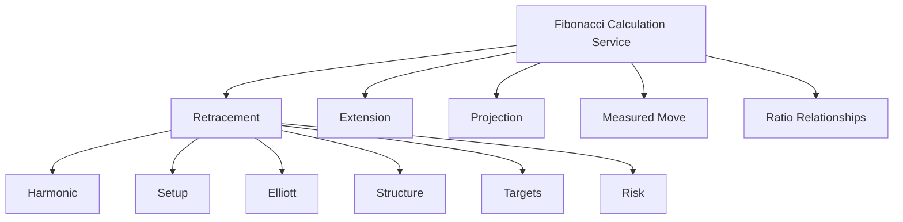

یک بار محاسبه، همه استفاده می‌کنند — اگر برای Fibonacci موتور مستقل سنگین بسازیم، معماری بی‌جهت پیچیده می‌شود

#### Harmonic — فرضیه‌ها حفظ می‌شوند

```
X → A → B → C → D
↓
Pattern Family
Pivot Sequence
Ratio Vector
Completion Zone
Invalidation
Confidence
```

اگر دو الگوی مختلف محتمل باشند، مجبور نیست یکی را حذف کند — هر دو Hypothesis می‌ماند

#### Ichimoku — ربات معامله‌گر مستقل نمی‌شود

Features: Tenkan, Kijun, Senkou A, Senkou B, Cloud Thickness, Cloud Slope, Price/Cloud, TK Cross, Chikou, Projected Cloud → Feature → Evidence/Context

#### Elliott Wave — ذاتاً Hypothesis-heavy

نمی‌گوید «قطعاً Wave 3 هستیم»

```
Wave Candidate A = 0.55
Wave Candidate B = 0.30
Wave Candidate C = 0.15
+ Invalidation Levels
+ Fibonacci Relations
```

عدم قطعیت حفظ می‌شود

---

### ۱۴. Setup → Playbook → Strategy — سه لایه جدا

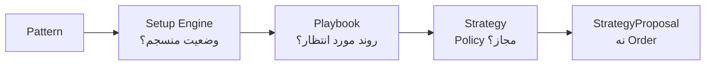

**Setup مثال:**

> Trend = Bullish + Structure = Bullish BOS + Liquidity = Sell-side Sweep + FVG = Fresh Bullish + OB = Valid + Momentum = Expanding + MTF = Aligned + Regime = Trend
> → Setup ID, Family, Evidence IDs, Required/Missing Conditions, Invalidation, Strength

**Playbook مثال:**

> Post-Sweep Reversal — Entry: Confirmation + Retest — Invalidation: Structural Breach — Management: Target Ladder + Trailing — هرگز Risk را دور نمی‌زند

**Strategy — Policy، نه مجموعه RSI>50 MACD> EMA>:**

> کدام Setup ها؟ در کدام Regime؟ در چه Direction؟ با چه Timing؟ با چه Management؟ با چه Invalidation؟ مجاز هستند — خروجی StrategyProposal است، نه Order

---

### ۱۵. پیش‌بینی — Statistical Forecast + AI Ensemble

#### Statistical Forecast

> در گذشته، در شرایطی شبیه شرایط فعلی، چه اتفاقی افتاده؟
> `P(Target Before Stop | Context, Regime, Setup)`

#### AI Ensemble — میانگین کور نمی‌گیرد

| مدل | P |
| :--- | :--- |
| Model A | 0.72 |
| Model B | 0.69 |
| Model C | 0.77 |
| Model D | 0.55 |

ابتدا: Calibration, Model Quality, OOD, Disagreement بررسی → سپس Ensemble

**اگر اختلاف شدید:**

| مدل | P |
| :--- | :--- |
| A | 0.85 |
| B | 0.82 |
| C | 0.30 |
| D | 0.25 |

میانگین ساده = 0.555 → «55.5% احتمال!» — گمراه‌کننده

GEN5:
> صبر کن؛ مدل‌ها شدیداً با هم اختلاف دارند → Dispersion ↑ → Uncertainty ↑ — اختلاف خودش Information است

---

### ۱۶. P / U / C — معنای دقیق سه عدد

| حرف | معنای دقیق | مثال |
| :--- | :--- | :--- |
| **P** | Probability احتمال رخ دادن Event کاملاً تعریف‌شده در Horizon مشخص | P=0.73 یعنی Event تعریف‌شده 73% |
| **U** | Uncertainty Model disagreement + Data quality + Regime instability + Distribution shift + Calibration uncertainty | U↑ یعنی عدم قطعیت بیشتر |
| **C** | Confidence اعتماد به کیفیت فرآیند Forecast است، نه خود Probability | C=0.78 |

**مثال منطقی:** `P=0.73 U=0.31 C=0.78`

> **Forecast بدون Horizon ناقص است:**
> P=72% به‌تنهایی تقریباً ناقص است — باید مشخص شود: احتمال 72% چه چیزی؟ در چند کندل؟ با چه Target؟ با چه Stop؟ با چه Cost؟ — بنابراین Forecast شامل Horizon, Target Definition, Stop Definition, Cost Model است

---

### ۱۷. Decision Engine — ارزش اقتصادی، نه جهت بازار

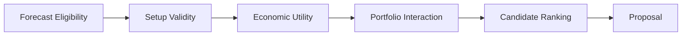

**مثال ۵ Setup همزمان:**

```
BTC Long
ETH Long
SOL Long
BTC Short
XRP Long
```

GEN5 مجبور نیست همه را اجرا کند — مقایسه با: Forecast Quality, Uncertainty, Context, Expected Utility, Correlation, Diversification, Parameter Validity — Portfolio-aware

**Proposal:**

```
BTCUSDT
Long
15m
Setup = Sweep-Reversal
P = 0.73
U = 0.21
C = 0.81
Expected Utility = Positive
```

هنوز معامله نشده است

---

### ۱۸. Risk Kernel — مهم‌ترین مرز امنیتی — مستقل از Forecast

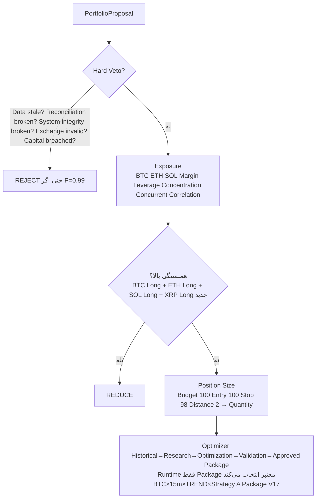

**نکته بسیار مهم Optimizer:**

> برداشت قبلی خطرناک: Optimizer هر لحظه میلیون‌ها ترکیب را Live جستجو کند و بهترین مقدار را برای همین معامله پیدا کند — GEN5 این را رد کرده
> Optimizer نباید Live میلیون‌ها ترکیب جستجو کند
> بلکه: Historical Data → Research → Optimization → Validation → Approved Parameter Package → Runtime فقط Package معتبر انتخاب می‌شود

**خروجی Risk — سه حالت رسمی:**

| حالت | مثال |
| :--- | :--- |
| `ALLOW` | Max Quantity = 0.03 BTC Risk Budget = $85 |
| `REDUCE` | Requested = 0.05 Allowed = 0.02 |
| `REJECT` | Reason = PORTFOLIO_CAPACITY |

قرارداد رسمی `RiskDecision` دقیقاً برای همین موضوع

---

### ۱۹. Trade Plan — تقریباً دستور اجرایی

```
Trade Plan ID
Symbol: BTCUSDT
Timeframe: 15m
Side: Long
Entry: 100
Quantity: 0.03
Leverage: 5x
Stop: 98
Targets: [106, 112, 118]
Trailing: ATR×1.5
Max Hold: 24h
Cooldown: 2h
Idempotency Key: o-a1b2c3d4
Risk Decision ID: RD-2026-08-24-001
```

---

### ۲۰. Execution Engine — یک State Machine، نه یک API Call

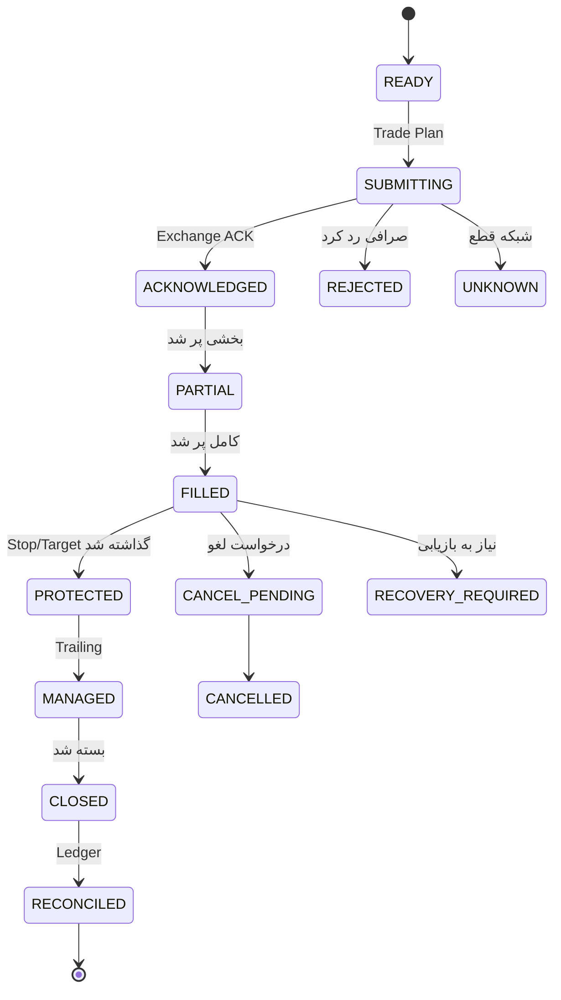

#### چرا Idempotency خیلی مهم است؟

> APEX سفارش را به Toobit می‌فرستد — شبکه قطع می‌شود — APEX نمی‌داند سفارش ارسال شد یا نه — اگر دوباره بفرستد ممکن است Order 1 = Filled + Order 2 = Filled → ناگهان دو معامله باز شود
> برای همین هر Trade Intent یک Idempotency Key دارد — اگر درخواست دوباره ارسال شد، سیستم ابتدا وضعیت قبلی را Reconcile می‌کند و بعد تصمیم می‌گیرد آیا Order جدید لازم است یا نه

---

### ۲۱. بعد از اجرا — Ledger = Reality

**Execution Report:**

| فیلد | مقدار |
| :--- | :--- |
| Intended Price | 100 |
| Actual Fill | 100.17 |
| Actual Quantity | 0.03 |
| Fees | 0.02% |
| Slippage | 0.17 |
| Order State | FILLED |
| Exchange ID | 92831 |

**Portfolio Position Lifecycle:**

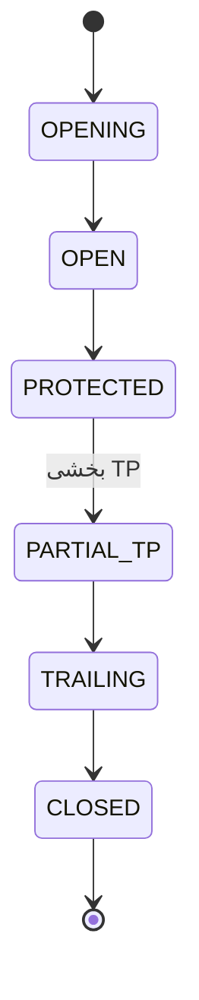

**Ledger — واقعیت نهایی:**

> تحلیل ممکن است بگوید: «من فکر می‌کردم Entry در 100 بوده»
> اما Ledger می‌گوید: «واقعیت این است که در 100.17 اجرا شد»
> بنابراین: **Ledger = Reality** نه Forecast

**Outcome Record:**

Entry, Exit, PnL, Fees, Slippage, MFE, MAE, Duration, Exit Reason, Risk Used, Forecast, Setup, Regime, Context — چه چیزی واقعاً رخ داد؟

---

### ۲۲. Attribution — چرا موفق یا ناموفق شد؟

معامله ضررده شد — سیستم نباید فقط بگوید `LOSS = -$72`

چک‌لیست:

- [ ] Setup valid?
- [ ] Forecast calibrated?
- [ ] Liquidity interpretation correct?
- [ ] Regime classification correct?
- [ ] Execution bad?
- [ ] Risk sizing excessive?
- [ ] MTF conflict ignored?
- [ ] Data quality poor?

این همان جایی است که **Failure Memory** شکل می‌گیرد

---

### ۲۳. شکست → Memory → Research → Optimizer → Validation → Approved Package

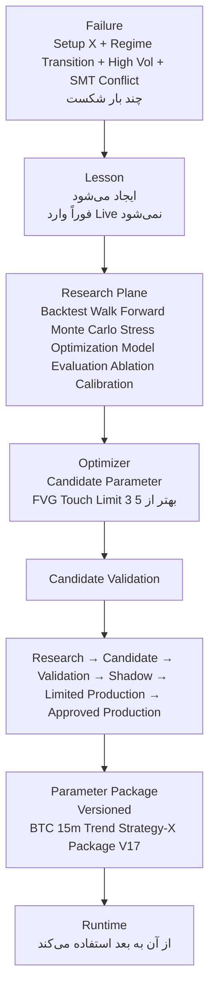

> **Optimizer نمی‌تواند مستقیماً Live را تغییر دهد — یکی از مهم‌ترین اصول GEN5**

---

### ۲۴. چرخه کامل — یک زنجیره ساده

```
کاربر
↓
Telegram (Control Plane — اتاق فرمان)
↓
Session (ID Symbol TF Mode Timestamp Env Param Package Version)
↓
Toobit (MarketObservation)
↓
Data Validation (Acquire → Schema → ... → Canonical Storage)
↓
Candle Status (MISSING PARTIAL CLOSED CORRECTED SUPERSEDED — فقط CLOSED مجاز)
↓
Raw Store (Single Source — View/Query Window — Not copy)
↓
Data Manager (Lookback per consumer — 1 / 50 / 100 / 200 / 500)
↓
Candle Intelligence (Market Observation → Candle Facts — Feature Registry — Feature ≠ Parameter)
↓
12 Operational Analysts (Evidence Events — Not voting)
↓
Cross-Domain (Correlation / Divergence / SMT / MTF — Not Motor 13)
↓
Conflict Resolver (CONFLICTING_HIGH_STRENGTH — Not 85+80=82 BUY)
↓
Evidence Fabric (EV001-008 با مشخصات کامل)
↓
Context Fabric (Market Regime Trend Stack Volatility Liquidity Structure MTF Correlation Divergence Session Pattern Environment Data Trust System Health)
↓
Pattern Intelligence (Candlestick Price Action Structural Harmonic Wave)
↓
Fibonacci (Shared Calculation Service — Retracement Extension Projection Measured Move)
↓
Harmonic (XABCD Family Pivot Ratio Completion Invalidation — Preserve both Hypothesis)
↓
Ichimoku (Tenkan Kijun Senkou A B Cloud Thickness Slope Price Cloud TK Cross Chikou Projected Cloud → Feature)
↓
Elliott Wave (Wave Candidate A 0.55 B 0.30 C 0.15 + Invalidation + Fibonacci — Uncertainty preserved)
↓
Setup (ID Family Evidence IDs Required Missing Invalidation Strength)
↓
Playbook (Post-Sweep Reversal Entry Confirmation Retest Invalidation Structural Breach Management Target Ladder Trailing)
↓
Strategy (Policy Which Setups Which Regime Which Direction Timing Management Invalidation → StrategyProposal)
↓
Statistical Forecast (P(Target Before Stop | Context Regime Setup) — Historical similar)
↓
AI Ensemble (Model A 0.72 B 0.69 C 0.77 D 0.55 — Calibration Quality OOD Disagreement — Dispersion ↑ Uncertainty ↑)
↓
P/U/C (P Probability defined Event Horizon U Uncertainty Model disagreement Data quality Regime instability Distribution shift Calibration C Confidence trust in process — P 0.73 U 0.31 C 0.78 — Horizon Target Stop Cost Model)
↓
Decision Engine (Forecast Eligibility → Setup Validity → Economic Utility → Portfolio Interaction → Candidate Ranking → Proposal — Portfolio-aware)
↓
Portfolio Proposal (BTCUSDT Long 15m Setup Sweep-Reversal P 0.73 U 0.21 C 0.81 Expected Utility Positive — Not yet traded)
↓
Risk Kernel (Independent — Hard Veto — Exposure — Position Size — Optimizer Historical→Research→Optimization→Validation→Approved Package)
↓
RiskDecision (ALLOW Max Quantity 0.03 BTC Budget 85 / REDUCE Requested 0.05 Allowed 0.02 / REJECT Reason PORTFOLIO_CAPACITY)
↓
Trade Plan (ID Symbol TF Side Entry Quantity Leverage Stop Targets Trailing Max Hold Cooldown Idempotency Key Risk Decision ID)
↓
Execution Engine (READY→SUBMITTING→ACKNOWLEDGED→PARTIAL→FILLED→PROTECTED→MANAGED→CLOSED→RECONCILED — Idempotency Key — Reconcile first)
↓
Toobit (Actual Execution)
↓
Execution Report (Intended Price Actual Fill Quantity Fees Slippage Order State Exchange ID Timestamp)
↓
Position (OPENING→OPEN→PROTECTED→PARTIAL TP→TRAILING→CLOSED)
↓
Portfolio
↓
Ledger (Reality — 100.17 not 100 thought)
↓
Outcome (Entry Exit PnL Fees Slippage MFE MAE Duration Exit Reason Risk Used Forecast Setup Regime Context)
↓
Attribution (Why success/failure? Setup valid? Forecast calibrated? Liquidity correct? Regime correct? Execution bad? Risk excessive? MTF conflict ignored? Data quality poor?)
↓
Failure/Success Memory (Lesson — Not immediately Live)
↓
Research (Backtest Walk Forward Monte Carlo Stress Optimization Model Evaluation Ablation Calibration)
↓
Optimizer (Candidate Parameter — FVG Touch Limit 3 better than 5)
↓
Candidate Validation (Research→Candidate→Validation→Shadow→Limited Production→Approved Production)
↓
Approved Parameter Package (Versioned BTC 15m Trend Strategy-X Package V17)
↓
Runtime
↓
Loop to Telegram Reports
```

---

### ۲۵. ۱۲ موتور — ۱۲ قابلیت تحلیلی، نه الزاماً ۱۲ Process سنگین

> در GEN5 وقتی می‌گوییم 12 Operational Analysts، الزاماً یعنی ۱۲ برنامه جداگانه که هرکدام Process مستقل داشته باشند نیست
> مثلاً ممکن است در کد: Structure, Liquidity, Volume, Volatility, ... همگی از یک سری Kernel محاسباتی مشترک استفاده کنند
> ولی از نظر مالکیت تحلیلی، Contract خروجی، Version و مسئولیت از هم جدا هستند
> این کار عمداً انجام شده تا **معماری تحلیلی را فدای معماری نرم‌افزاری نکنیم**
> یعنی «۱۲ قابلیت تحلیلی» داریم، نه الزاماً «۱۲ Process سنگین»

---

### ۲۶. APEX GEN5 واقعاً چه ساخته؟ — Ultimate Fallback

GEN5 دیگر صرفاً یک Trading Signal Generator نیست — بلکه یک زنجیره تبدیل اطلاعات است:

**DATA → FACT → EVIDENCE → CONTEXT → PATTERN → SETUP → FORECAST → PROPOSAL → RISK → ACTION → REALITY → LESSON → VALIDATED IMPROVEMENT**

و مهم‌ترین فلسفه این است که هر مرحله حق ندارد نقش مرحله بعدی را بازی کند.

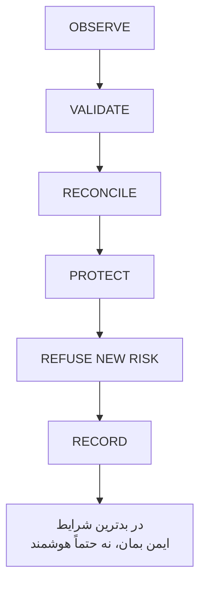

**این همان Ultimate Fallback تعریف‌شده برای GEN5 است.**

---

### ۲۷. چک‌لیست نهایی — آیا متن اصلی حفظ شد؟

- [x] Telegram Control Plane — اتاق فرمان — Intent only — Session ID Symbol TF Mode Timestamp Env Param Package Version — قابل بازسازی زنجیره
- [x] Toobit MarketObservation — OHLCV + OI Separate + Temporal Alignment + Canonical Market State — اصلاح Kline لزوماً همراه OI نیست
- [x] Data Validation — Acquire → ... → Canonical Storage — هیچ تحلیلی هنوز
- [x] Candle Status MISSING PARTIAL CLOSED CORRECTED SUPERSEDED — فقط CLOSED مجاز — Future Leak Prevention
- [x] Raw Store Single Source — View/Query Window — Not copy per motor — Data Manager Lookback per consumer — PEBBLE/BASTION/CITADEL
- [x] Candle Intelligence — Feature Registry Not Fixed 100 — Body Range Wick Close Position Direction Gap Volume Ratio OI Change Range/ATR Return — مثال BTC Open 100 High 110 Low 98 Close 106 → Body 6 Range 12 Body/Range 0.50 Upper Wick 4 Lower Wick 2 Close Position 0.67 Direction Bullish — Fact مشتق‌شده نه Parameter — Feature ≠ Parameter Observation ≠ Rule Rule ≠ Forecast Forecast ≠ Trade
- [x] 12 Analysts — Structure Liquidity Volume Volatility FVG OrderBlock ICT SMC RTM Wyckoff Trend Momentum Regime Session Temporal — Not voting — Evidence Event Strength Confidence
- [x] Structure BOS با Body Quality Close Acceptance Volume Participation Persistence MTF Alignment — Liquidity Equal Lows Price dips Rejection Returns above Reference Liquidity — FVG Lifecycle Created Fresh Touched Mitigated Invalidated Expired Age Touch Mitigation Context — OrderBlock Origin Displacement Structural Consequence Persistence Mitigation — Trend Micro Short Intermediate Macro Direction Strength Persistence Transition MTF Agreement — Momentum Velocity Acceleration Deceleration Impulse Exhaustion Divergence Price rising velocity decreasing Exhaustion — Regime State Vector Trendiness Volatility Liquidity Compression Expansion Persistence Uncertainty Transition Probability Label TREND RANGE HIGH_VOL LOW_VOL EXPANSION COMPRESSION TRANSITION UNCERTAIN
- [x] Cross-Domain — Correlation BTC→ETH BTC→SOL Price→OI Price→Volume — Divergence Price vs Volume OI Momentum Structure Asset A vs B Liquidity vs Price — SMT Asset A Structure vs Asset B Structure vs Shared Liquidity Context — SMT ≠ Correlation — Not Motor 13 — MTF Alignment ALIGNED CONFLICTING — Conflict Resolver CONFLICTING_HIGH_STRENGTH Not 85+80=82 BUY
- [x] Evidence Fabric EV001-008 با مشخصات کامل Source Timestamp Symbol TF Strength Confidence Quality Validity Lifecycle Parameter Version Lineage
- [x] Context Fabric Regime Trend Stack Volatility Liquidity Structure MTF Correlation Divergence Session Pattern Environment Data Trust System Health — What environment? Not Buy now
- [x] Pattern Intelligence — Fibonacci Shared Calculation Service Retracement Extension Projection Measured Move Ratio Relationships Consumers Harmonic Setup Elliott Structure Targets Risk — Not heavy motor — Harmonic XABCD Family Pivot Sequence Ratio Vector Completion Zone Invalidation Confidence Preserve both Hypothesis — Ichimoku Tenkan Kijun Senkou A B Cloud Thickness Slope Price Cloud TK Cross Chikou Projected Cloud → Feature → Evidence/Context — Elliott Wave Candidate A 0.55 B 0.30 C 0.15 Invalidation Fibonacci Relations Uncertainty preserved
- [x] Setup Engine — Trend Bullish Structure BOS Liquidity Sell-side Sweep FVG Fresh Bullish OB Valid Momentum Expanding MTF Aligned Regime Trend → Setup ID Family Evidence IDs Required Missing Invalidation Strength
- [x] Playbook — Post-Sweep Reversal Entry Confirmation Retest Invalidation Structural Breach Management Target Ladder Trailing — Never bypass Risk
- [x] Strategy — Policy Which Setups Which Regime Which Direction Which Timing Which Management Which Invalidation — StrategyProposal Not Order — Not RSI>50
- [x] Statistical Forecast — P(Target Before Stop | Context Regime Setup) — Historical similar
- [x] AI Ensemble — Model A 0.72 B 0.69 C 0.77 D 0.55 Calibration Quality OOD Disagreement — Dispersion ↑ Uncertainty ↑ — Example A 0.85 B 0.82 C 0.30 D 0.25 Average 0.555 misleading GEN5 says wait dispersion high
- [x] P/U/C — P Probability defined Event Horizon U Uncertainty Model disagreement Data quality Regime instability Distribution shift Calibration C Confidence trust in process Example P 0.73 U 0.31 C 0.78 — Forecast without Horizon incomplete — Horizon Target Stop Cost Model
- [x] Decision Engine — Forecast Eligibility → Setup Validity → Economic Utility → Portfolio Interaction → Candidate Ranking → Proposal — Portfolio-aware 5 Setups BTC Long ETH Long SOL Long BTC Short XRP Long Compare Forecast Quality Uncertainty Context Expected Utility Correlation Diversification Parameter Validity — PortfolioProposal BTCUSDT Long 15m Setup Sweep-Reversal P 0.73 U 0.21 C 0.81 Expected Utility Positive Not yet traded
- [x] Risk Kernel — Independent — Hard Veto Data stale Reconciliation System integrity Exchange Capital breached REJECT even P 0.99 — Exposure BTC ETH SOL Total Margin Leverage Concentration Concurrent Correlation REDUCE — Position Size Budget 100 Entry 100 Stop 98 Distance 2 Quantity Budget/Distance Exchange Portfolio — Optimizer Historical→Research→Optimization→Validation→Approved Package Runtime only selects valid Package — RiskDecision ALLOW REDUCE REJECT
- [x] Trade Plan — ID Symbol TF Side Entry Quantity Leverage Stop Targets Trailing Max Hold Cooldown Idempotency Key Risk Decision ID — Almost executable
- [x] Execution Engine — State Machine READY SUBMITTING ACKNOWLEDGED PARTIAL FILLED PROTECTED MANAGED CLOSED RECONCILED REJECTED UNKNOWN CANCEL_PENDING CANCELLED RECOVERY_REQUIRED — Idempotency Key Reconcile first Prevent double fill — Execution Report Intended Price Actual Fill Quantity Fees Slippage Order State Exchange ID Timestamp — Portfolio OPENING OPEN PROTECTED PARTIAL TP TRAILING CLOSED — Ledger Reality 100.17 not 100 thought — Outcome Entry Exit PnL Fees Slippage MFE MAE Duration Exit Reason Risk Used Forecast Setup Regime Context — Attribution Why Setup valid Forecast calibrated Liquidity correct Regime correct Execution bad Risk excessive MTF conflict Data quality — Failure Memory Lesson Setup X Regime Transition High Vol SMT Conflict failed → Lesson Not immediately Live
- [x] Research Plane — Backtest Walk Forward Monte Carlo Stress Optimization Model Evaluation Ablation Calibration — Optimizer Candidate FVG Touch Limit 3 better than 5 — Candidate Validation Research→Candidate→Validation→Shadow→Limited Production→Approved Production — Optimizer cannot directly change Live — Parameter Package Versioned BTC 15m Trend Strategy-X Package V17 — Full Chain — Seven Invariants — Twelve Analysts shared Kernel separate ownership — Ultimate Fallback OBSERVE VALIDATE RECONCILE PROTECT REFUSE NEW RISK RECORD

**مفهوم اصلی ۱۰۰٪ حفظ شد — فقط نگارش حرفه‌ای، بصری، مرتب، قابل فهم — بدون تغییر در اصل مفاهیم**

---

*End of Professional Dataflow Document — Ready for Reader — Visual, Structured, Flawless — Based on Your Original 22-Second Narrative — No Concept Changed*
